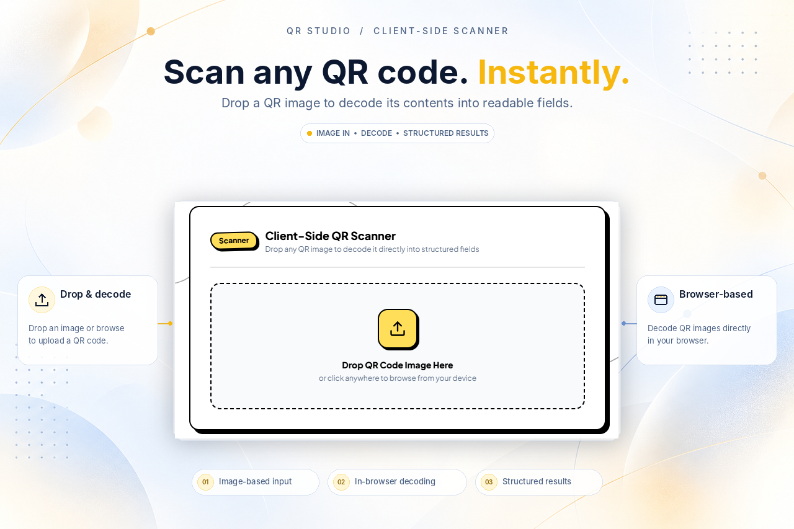
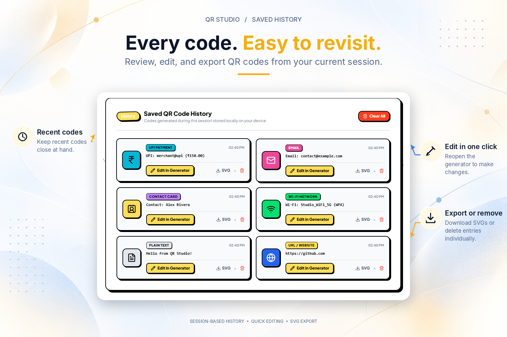

<div align="center">
<h1> QR Studio </h1>

A browser-based workspace for creating, customizing, and scanning QR
codes.

[](https://nextjs.org/)
[](https://react.dev/)
[](https://www.typescriptlang.org/)
[](https://tailwindcss.com/)
[](https://qr-codegenerator-three.vercel.app/)

[Live Demo](https://qr-codegenerator-three.vercel.app/) · [Report an
Issue](https://github.com/Harsh031202/qr-generator-V2/issues)

</div>

## Screenshots

<table>
  <tr>
    <td align="center" width="50%">
      
      <br>
      <b>Home Page</b>
    </td>
    <td align="center" width="50%">
      
      <br>
      <b>Customisation</b>
    </td>
  </tr>
  <tr>
    <td align="center" width="50%">
      
      <br>
      <b>Preview</b>
    </td>
    <td align="center" width="50%">
      
      <br>
      <b>Scanner</b>
    </td>
  </tr>
  <tr>
    <td align="center" width="50%">
      
      <br>
      <b>History</b>
    </td>
    <td align="center" width="50%">
      
      <br>
      <b>Dark Mode</b>
    </td>
  </tr>
</table>


## Overview

QR Studio lets you create QR codes for common types of information,
adjust their appearance, and decode QR codes from uploaded images. The
interface brings generation, scanning, and recent-code history into one
workspace.

## Features

### Create QR codes

-   Generate codes for URLs, plain text, Wi-Fi networks, contact cards
    (vCards), email messages, and UPI payment details.
-   Preview the QR code while editing its content.
-   Customize foreground and background colors.
-   Adjust the quiet-zone margin and error-correction level.
-   Export as PNG with a selectable resolution or as SVG.
-   Copy the generated QR image to the clipboard when supported by the
    browser.
-   Start with sample presets for URLs, Wi-Fi, and contact cards.

### Scan QR images

-   Upload or drag and drop an image containing a QR code.
-   Decode the code in the browser.
-   View recognized content in structured fields for supported payload
    types.
-   Copy decoded values or inspect the raw payload.
-   Show or hide decoded Wi-Fi passwords.

### History

-   Revisit recently generated codes from the History tab.
-   Edit a history entry in the generator or remove individual entries.
-   Clear the current history.

**History note:** Recent-code history is held in the current page state.
It is temporary and may reset when you refresh or close the page.

## Tech stack

-   **Next.js 15** --- App Router
-   **React 19** --- UI
-   **TypeScript** --- application types
-   **Tailwind CSS** --- styling
-   **`qrcode`** --- QR code generation
-   **`jsQR`** --- QR code decoding
-   **Lucide React** --- icons

## Run locally

### Requirements

-   [Node.js](https://nodejs.org/) and npm

### Setup

``` bash
git clone https://github.com/Harsh031202/qr-generator-V2.git
cd qr-generator-V2
npm install
npm run dev
```

Open <http://localhost:3000> in your browser.

### Production build

``` bash
npm run build
npm run start
```

## Project structure

``` text
qr-generator-V2/
├── app/                    # App Router pages, layout, and global styles
├── components/
│   ├── editor/             # Forms for QR content types
│   ├── layout/             # Navigation and workspace layout
│   ├── qr/                 # QR generator, scanner, and history
│   └── ui/                 # Reusable UI components and icons
├── lib/
│   ├── qr/                 # QR generation, encoding, and decoding
│   └── validation/         # Input and payload validation
├── types/                  # Shared TypeScript types
├── package.json
└── tailwind.config.ts
```

## Notes

-   QR generation and image decoding run on the client side; these
    features do not require a separate application server or database.
-   A static QR code contains the data encoded when it was created. It
    cannot be edited after printing unless it points to a destination
    you control.
-   Clipboard functionality depends on browser support and permissions.
-   Check links before opening them. QR codes can contain malicious or
    otherwise untrusted URLs.

## License

No license file is currently included in this repository. Add a
`LICENSE` file if you want to specify how others may use, modify, and
distribute this project.
